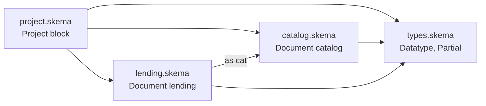

# 02 — Project & Documents

[← Index](README.md)

skema has exactly two levels above declarations.

| | `Project` | `Document` |
|---|---|---|
| Count | exactly one per project | exactly one per file |
| Required | yes | yes |
| Governs | mode, dialect, lint, project-wide styles | this file's namespace, file metadata |
| Analogous to | `Cargo.toml` / `tsconfig.json` | a `package` declaration in Java or Go |

A ten-file project has ten `Document` blocks and **one** `Project` block. A second `Project` declaration anywhere — including in an imported file — is an error.

## Document is the namespace

```skema
spec 1;

Document shop { }

Enum  OrderStatus { … }     # full name: shop.OrderStatus
Table Order       { … }     # full name: shop.Order
```

Declarations sit **beside** `Document`, not inside it — the block declares the file's identity, it does not enclose its contents. `Document` may appear anywhere at the top level: before, between, or after declarations. Only `spec` has a fixed position.

The document name is independent of the filename: `myexample.skema` may declare `Document shop`.

## Referencing within vs. across files

Inside the same file, a prefix is **optional**. On an imported declaration, it is **mandatory**:

```skema
Document shop { }

Enum OrderStatus { paid; }

Table Order {
  status   OrderStatus [default=OrderStatus.paid];   # local — no prefix needed
  currency base.Currency;                             # imported — prefix required
}
```

Rule you can apply while reading: **a prefix in the source always means "this comes from another file."**

## Imports

```skema
import "./common.skema" as base;
```

- The path is relative to the importing file.
- `as <alias>` binds the imported content to a local namespace prefix.
- Without `as`, the imported file's own `Document` name is used.

```skema
# ---- customer.skema ----
Document customer { }
Table User { id int [pk]; }
```

```skema
# ---- order.skema ----
Document shop { }

import "./customer.skema";              # reachable as  customer.User.id
import "./customer.skema" as user;      # reachable as  user.User.id
```

The alias applies **only in the importing file** — the same file can appear as `user` in `order.skema` and as `customer` in `invoice.skema`.

### Namespace uniqueness

Every namespace visible in a file — including the file's own `Document` name — must be unique. Two imports resolving to the same document name is an error until one is renamed with `as`:

```skema
import "./de/common.skema";           # Document common
import "./en/common.skema" as en;     # Document common, renamed
```

### What an import brings in

An import makes the other file's **declarations** visible — `Table`, `Enum`, `Partial`, `Datatype`, `Group`. It does **not** bring in that file's `Document` metadata or `Style` blocks.

### Imports are not transitive

If `a` imports `b`, and `b` imports `c`, declarations from `c` are **not** visible in `a`. A file that needs `c` imports `c` directly. The import list at the top of a file is therefore the complete dependency list for that file — restructuring `b` cannot silently break `a`.

### Import cycles are allowed

```skema
# ---- order.skema ----
Document shop { }
import "./customer.skema";
Table Order { buyer >customer.User.id; }

# ---- customer.skema ----
Document customer { }
import "./order.skema";
Table User { last_order >shop.Order.id; }
```

Mutual references are the normal case in an ER model, so the language does not force files apart to avoid them. Resolution works because declarations are order-independent — tooling collects every name across the whole graph before checking references.



Import graph of [`examples/generic/`](../../examples/generic/). `project.skema` is the root file — the one handed to tooling.

## The root file

Exactly one file in a project carries the `Project` block. That file is the **root file**: it imports — directly or through intermediate files — everything that belongs to the project, and it's what gets passed to tooling:

```bash
skema check main.skema
skema export --json main.skema
```

Consequences:

1. **Project membership is reachability-defined.** A `.skema` file not reachable from the root file is not part of the project, even if it sits in the same directory. The import graph *is* the project definition.
2. **The import graph is a tree with one root.** A second `Project` declaration anywhere in the graph is an error.
3. **A single file cannot be fully checked in isolation.** `mode` and `dialect` live in the root file; without them, it is not decidable whether a given type is allowed.

## The Project block

```skema
Project {
  mode    = draft;      # draft | strict
  dialect = generic;    # generic | postgres | mysql | oracledb

  Meta  { … }
  Style @table { … }
  Lint  { … }
}
```

### The mode switch

`mode` is more than a type-strictness setting — it decides whether the project is checked against rules at all.

| | `mode = draft` | `mode = strict` |
|---|---|---|
| Lint rules | ignored | enforced |
| Data types | simple types suffice: `string`, `int`, `float`, `bool` | precise types required |
| Intended for | sketching, first pass | a model meant for code generation |

Switching from `draft` to `strict` turns every previously-ignored inconsistency into a visible diagnostic — the switch costs one word.

`Lint` has no effect while `mode = draft`. It remains valid to write it there — it documents what *will* apply once the project switches.

### Dialect selection

`dialect` selects the target database and, with it, the available type table. `generic` means portable types only, nothing engine-specific.

`mode` and `dialect` combine into three practical tiers:

| `mode` | `dialect` | Allowed types |
|---|---|---|
| `draft` | `generic` | `string`, `int`, `float`, `bool` |
| `strict` | `generic` | precise but portable — `varchar(80)`, `decimal(10,2)`, `timestamp`, `uuid` |
| `strict` | `postgres` / `mysql` / `oracledb` | plus engine-specific types — `jsonb`, `tsvector`, `citext`, … |

The middle tier — precise but still portable — is the target state for a maintained model; the third tier deliberately trades portability for engine-specific power.

### Meta and Style on Project

Covered in [03 — Meta & Style](03-meta-and-style.md).

### Lint

Covered in [04 — Linting](04-linting.md).

### Database on Project

Project-wide physical defaults (database name, default schema) — covered in [11 — Physical Mapping](11-physical-mapping.md).

## See also

- [01 — Language Basics](01-language-basics.md) — statement forms and casing rules
- [09 — Partials](09-partials.md) — reusing declarations with `use` (a different mechanism from `import`)
- [11 — Physical Mapping](11-physical-mapping.md) — `Database` block, physical names
