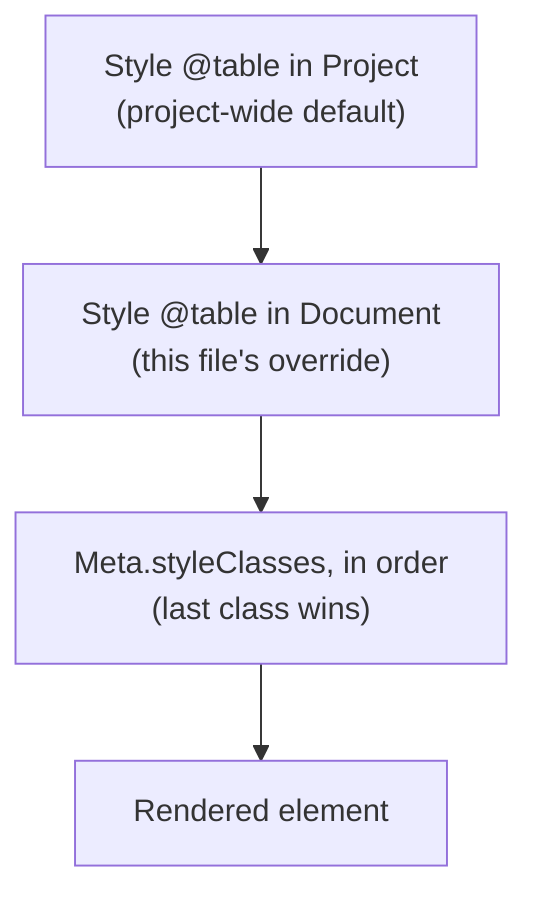

# 03 — Meta & Style

[← Index](README.md)

Both blocks belong to the `{}` side of the language ([01 — Brackets and braces](01-language-basics.md#brackets-and-braces)): they describe, they don't generate schema.

- **`Meta`** — knowledge *about* a declaration: who, why, what state.
- **`Style`** — appearance in the diagram.

## Meta

```skema
Table Customer {
  id int [pk];

  Meta {
    author       = "anna";
    note         = "Customer master data, GDPR-relevant";
    version      = "1.2";
    styleClasses = [highlight];
    "x-jira"     = "SHOP-412";
  }
}
```

### Standard keys

| Key | Type | Meaning |
|---|---|---|
| `author` | string | Who designed this — for collaboration and questions. |
| `note` | string | Domain description. Feeds editor hover text and generated DDL comments. |
| `version` | string | The model's own revision — see [`spec` vs `Meta.version`](01-language-basics.md#spec-vs-metaversion). |
| `styleClasses` | list | Assigns style classes — see [Style classes](#style-classes) below. |

Custom keys follow the `x-` rule from [01 — Custom keys](01-language-basics.md#custom-keys).

### Where Meta is allowed

Inside any top-level declaration: `Project`, `Document`, `Table`, `Partial`, `Enum`, `Group`, `Datatype`. A field describes itself in its own body instead — see [05 — Zone 3: Body](05-tables-and-fields.md#zone-3-body).

## Style — two forms, marked by @

```skema
Style @table   { … }    # selector: applies to ALL tables
Style highlight { … }   # class: applies only where assigned
```

`@` means: built-in element type of the language. No `@` means: user-chosen name.

### Selectors

| Selector | Applies to |
|---|---|
| `@project` | the whole diagram's frame |
| `@document` | every element of one file |
| `@table` | table boxes |
| `@enum` | enum boxes |
| `@group` | group frames |
| `@relation` | relationship lines — color, line style, arrowhead |

### Style classes

A class is a `Style` block **without** `@`. It has no effect until assigned via `Meta.styleClasses`:

```skema
Project {
  Style @table {
    headerBackgroundColor = "#cc0000";
    headerTextColor       = "white";
  }

  Style highlight {
    borderColor = "#cc0000";
    borderWidth = "3px";
  }
}

Table Order {
  Meta { styleClasses = [highlight]; }
}
```

## Cascade

There is **no** styling directly on an individual element. To highlight one table, define a class and assign it — this keeps every visual decision in one place instead of scattered through the model.

Three cascade levels, weakest to strongest:

1. `Style @…` in `Project` — project-wide default
2. `Style @…` in `Document` — this file's override
3. Classes from `styleClasses`, in list order — the last one wins

Rule: **more specific beats more general, later beats earlier.** No specificity arithmetic to memorize.



## Style properties

Property names are decided by `@skema/diagram`, not the language. The language validates only the *shape* of each entry:

- Unquoted keys must be camelCase — e.g., `headerBackgroundColor`, not `Header_Background_Color` or `HEADERBACKGROUNDCOLOR`.
- Quoted keys follow the `x-` custom-key rule (must start with `x-`; see [01 — Custom keys](01-language-basics.md#custom-keys)).
- Values must be strings — `"#cc0000"`, not `5` or `[a, b]`.

```skema
Style @table {
  headerBackgroundColor = "#cc0000";   # valid — camelCase key, string value
  "x-mermaidClass"      = "important"; # valid — custom key, string value
}
```

### Complete property reference

The properties below are the complete catalog recognized by `@skema/diagram`. Unrecognized properties are silently dropped.

#### Value grammar

| Type | Format |
|---|---|
| color | Hex: `#RGB` or `#RRGGBB`; or [CSS named color](https://www.w3.org/wiki/CSS/Properties/color/keywords) |
| width | Length: `3px`, `0.5em`, `1rem`, `1pt`; or keyword: `thin`, `medium`, `thick` |
| line style | `solid`, `dashed`, `dotted` |
| font size | Length: `12px`, `1.1em`, `1rem`, `14pt`, `80%`; or keyword: `small`, `medium`, `large`, `x-large` |

#### @table and @enum

Tables and enums share the same box styling. Note: `bodyBackgroundColor` is the explicit name for the body fill; both it and `backgroundColor` are accepted as aliases, with `bodyBackgroundColor` taking precedence when both are set.

| Property | Type | Meaning |
|---|---|---|
| `headerBackgroundColor` | color | Header fill color |
| `headerTextColor` | color | Header text color |
| `backgroundColor` (or `bodyBackgroundColor`) | color | Body fill color |
| `borderColor` | color | Border color |
| `borderWidth` | width | Border thickness |
| `borderStyle` | line style | Border line style |

#### @group

| Property | Type | Meaning |
|---|---|---|
| `backgroundColor` | color | Group frame fill color |
| `borderColor` | color | Frame border color |
| `borderWidth` | width | Border thickness |
| `borderStyle` | line style | Border line style |

#### @project

| Property | Type | Meaning |
|---|---|---|
| `backgroundColor` | color | Diagram background color |
| `fontSize` | font size | Base font size for element labels |

#### @document

| Property | Type | Meaning |
|---|---|---|
| `backgroundColor` | color | Override diagram background for this file's elements |

Note: Detailed inheritance and cascade rules for `@document` styling are under development — see [task 41](../../brain/tasks/41-document-style-cascade-inheritance.md).

#### @relation

| Property | Type | Meaning |
|---|---|---|
| `lineColor` | color | Relationship line color |
| `lineWidth` | width | Line thickness |
| `lineStyle` | line style | Line style (solid, dashed, dotted) |

## Full example

```skema
Project {
  Style @project  { fontSize = "1.1em"; }
  Style @table    { headerBackgroundColor = "#1f4e79"; headerTextColor = "white"; }
  Style @relation { lineColor = "#888888"; }

  # Classes carry no @ — they are assigned via Meta.styleClasses
  Style core       { borderColor = "#1f4e79"; borderWidth = "3px"; }
  Style historical { backgroundColor = "#f0f0f0"; }
}

Table Author {
  Meta { styleClasses = [core]; }
}

Table LoanArchive {
  Meta { styleClasses = [historical]; }
}
```

From [`examples/generic/`](../../examples/generic/).

## See also

- [12 — Groups](12-groups.md) — the `@group` selector's target
- [04 — Linting](04-linting.md) — the other project-wide governance block
- [11 — Physical Mapping](11-physical-mapping.md) — the same cascade pattern applied to physical names
