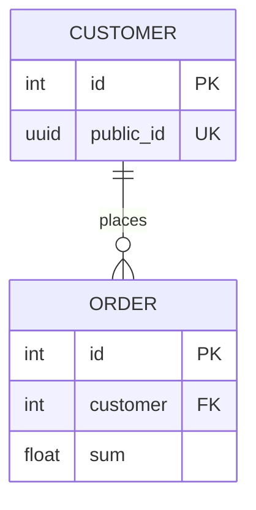

# 07 — Relationships

[← Index](README.md)

## Grounding

A relationship is a field whose type is an arrow to another field:

```skema
Table Order {
  customer >Customer.id [onDelete=cascade];
}
```

This fits the [one declaration shape](01-language-basics.md#the-one-declaration-shape): `customer` is the name, `>Customer.id` is the type, `[…]` are the flags.

The field's data type is **not written out** — it is derived from the target field. If `Customer.id` is `int`, `Order.customer` is `int` too: both ends of a relationship must share a type, and a value that can be derived should not be duplicated in the source.

## The arrows

> **The arrow points to the side where there is exactly one.**

| Notation | Meaning | Foreign key column created by this line |
|---|---|---|
| `a >B.b` | many `A` belong to one `B` | in `A` |
| `a <B.b` | one `A` has many `B` | none — the column belongs to `B`'s own `>` line |
| `a -B.b` | one to one | in `A`, plus `UNIQUE` |

```skema
Table Order {
  customer >Customer.id;      # many orders -> one customer
}
```

Because the arrow points at the "one" side, a `>` field always sits **on the many side** — exactly where the column is created too.

## Many-to-many has no arrow

SQL has no native many-to-many relationship — it always needs a junction table, so the model writes it out directly:

```skema
Table OrderPosition {
  order   >Order.id;
  product >Product.id;
  amount  int;
  price   Money;
}
```

This is more honest than an arrow that silently creates a table nobody named — and it pays off early: almost every many-to-many relationship eventually needs an extra field (quantity, date, ordering), which has a natural home here from the start.

## Not every relationship creates a column

This is the detail most easily missed, because every arrow looks the same at a glance:

```skema
Table Order {
  customer >Customer.id;      # creates column Order.customer
}

Table Customer {
  orders   <Order.customer;   # creates NO column
}
```

A `<` field is a **backreference**: it names the reverse direction for diagrams, ORMs, and documentation, but the foreign key lives on the other table. Looking for `orders` as a generated column will not find it — that's correct.

## One-to-one

`-` is written symmetrically, but the schema isn't: one side gets the column plus `UNIQUE` — whichever side the field is written on, same rule as `>`.

```skema
Table Profile {
  user -User.id;      # column Profile.user, UNIQUE
}
```

General rule for every arrow: **the column appears where the line is written** — except `<`, which creates none.

## Both sides may declare, flags apply only to one side

`A.x <B.y` and `B.y >A.x` describe the same relationship. Both may appear in the model; tooling recognizes them by the column pair and draws one edge, not two.



To keep two locations from ever going out of sync, a hard rule applies:

> **Flags are written only on the `>` side.**

```skema
Table Order {
  customer >Customer.id [onDelete=cascade];    # behavior lives here
}

Table Customer {
  orders <Order.customer;                      # backreference only
  orders <Order.customer [onDelete=restrict];  # ERROR
}
```

`onDelete` describes what happens to the foreign key column. That column exists exactly once, so its annotation may exist exactly once too.

## Flags

```skema
customer >Customer.id [onDelete=cascade, onUpdate=restrict];
```

| Flag | Values |
|---|---|
| `onDelete` | `cascade`, `restrict`, `setNull`, `setDefault`, `noAction` |
| `onUpdate` | same values |

Values are lowercase, like every value in the language (`mode = draft`, `type = float`).

## The target column is always named

```skema
customer >Customer.id;      # correct
customer >Customer;         # not allowed
```

There is no shorthand that implicitly targets the primary key — the target table would have to be looked up to know what's referenced. A relationship is where two tables touch; being explicit there is worth the extra characters.

## Physical foreign key column name

By default the column takes the field's name unchanged (`customer`, not `customer_id`) — a field named `customer_id` produces a column named `customer_id`. An explicit override via `[column="…"]` is covered in [11 — Physical Mapping](11-physical-mapping.md#physical-column-name); the exact convention for automatic suffixing is still being finalized — see [Reference → Known limitations](13-reference.md#known-limitations).

## Worked example — junction table with extra fields

```skema
Table Member {
  email types.Email [required, unique];
}

Table Copy {
  barcode varchar(32) [required, unique];
}

Table Loan {
  member      >Member.id [required, onDelete=restrict];
  copy        >Copy.id   [required, onDelete=restrict];
  lent_on     date        [required, default=`now()`];
  due_on      date        [required];
  returned_at timestamp;
}
```

From [`examples/generic/lending.skema`](../../examples/generic/lending.skema): `Loan` is the junction table between `Member` and `Copy`, carrying loan-specific fields that a generated pivot table would have had no place for.

## No cycles of `required` foreign keys

A `required` (or `pk`, which implies `required`) `>`/`-` relationship never
allows `NULL`, so its row must be inserted after the row it points to. If
these relationships form a cycle, no insert order exists in any target
database — every row in the cycle needs a not-yet-existing row to already
exist first, including the one-table case, a `required` self-reference:

```skema
Table Employee {
  id      int [pk];
  manager >Employee.id [required];   # ERROR — no first employee could ever be inserted
}
```

This is checked unconditionally, in every `mode`, independently of `Lint` —
unlike a naming convention, it isn't a style a team can opt out of. An
`optional` link anywhere in the cycle (the default — see "Nullability" in
[05 — Tables & Fields](05-tables-and-fields.md)) breaks it: that row can be
inserted as `NULL` first and back-filled.

## See also

- [05 — Tables & Fields](05-tables-and-fields.md) — flags in general
- [10 — Indexes](10-indexes.md) — indexing foreign key columns
- [11 — Physical Mapping](11-physical-mapping.md) — physical column names
