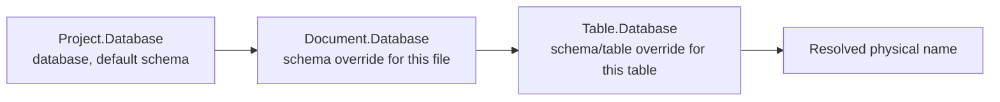

# 11 — Physical Mapping

[← Index](README.md)

A model has two names for everything: the **business** name and the **physical** name.

```skema
Table Order          # business name:  Order
                     # physical name:  "orders" in schema "sales"
```

`Database` is the single place these physical names live.

## The Database block

| Key | Meaning | Allowed in |
|---|---|---|
| `database` | database name | `Project`, `Document` |
| `schema` | schema name | `Project`, `Document`, `Table` |
| `table` | physical table name | `Table` |

Each key means the same thing at every level — there is no single overloaded `name` key whose meaning depends on where it appears.

## Three levels, one override rule

```skema
# ---- project.skema ----
Project {
  Database {
    database = "shopsystem";
    schema   = "public";
  }
}

# ---- order.skema ----
Document shop {
  Database { schema = "sales"; }     # applies to every table in this file
}

Table Order {
  Database { table = "orders"; }     # -> shopsystem.sales.orders
}

Table Position {
  Database { schema = "archive"; }   # -> shopsystem.archive.Position
}

Table Note { }                       # -> shopsystem.sales.Note
```

The cascade matches [`Style`](03-meta-and-style.md#cascade): **general is overridden by specific.** `Project` sets the default, `Document` refines it per file, `Table` refines it per table. Anything left unset falls back to the business name: `Table Note` without a `table` key is physically `Note`.



The `Document` level pays off in practice: a file usually maps to one schema. Without it, `schema = "sales"` would have to be repeated on every table in the file.

The physical schema is **not** derived automatically from the `Document` name — namespace and schema are two different concerns; write one line if the project wants them to match.

## Physical column name

```skema
Table Customer {
  email varchar [column="email_address"];
}
```

Same rule as everywhere else in the language: `[]` changes generated DDL, so the physical column name is a flag, not a body key. Tables use a block for this because they carry several physical facts at once (database, schema, name); a field carries exactly one, so it gets a flag instead.

## Engine-specific settings

Some settings apply to one engine only: `TABLESPACE` in Postgres, `ENGINE`/`CHARSET` in MySQL. They go in a `Dialect` block — the same shape as the [`Dialect @engine` blocks in `Datatype`](06-data-types.md#dialect-engine-blocks), `@` included:

```skema
Table Order {
  Database {
    table = "orders";

    Dialect @postgres { tablespace = "fast_ssd"; }
    Dialect @mysql    { engine = "InnoDB"; charset = "utf8mb4"; }
  }
}
```

The engine name carries `@` here for the same reason it does inside `Datatype`: it is [a name belonging to the language](01-language-basics.md#the-at-sign-convention), not one the project chose. There is one spelling in both places.

## Reserved words and identifier length

Under `mode = strict` with a real `dialect` (not `generic`), every *resolved* physical name — table, column, schema, database — is checked against that engine's reserved words (case-insensitive) and its identifier length limit, in bytes. `draft` and `generic` get no diagnostic at all: the check has nothing decided to check against a `generic` project, and `draft` is a sketch, not yet the state a model is generated from.

The check follows the same cascade as everywhere else in this document: it sees `table = "order"` on a `Table` named `Order`, not the business name, because the physical name is what `CREATE TABLE` receives.

Postgres's limit is 63 bytes, MySQL's is 64 — both fixed. Oracle's is configurable, since real Oracle databases differ on it:

```skema
Project {
  mode    = strict;
  dialect = oracledb;

  Database {
    Dialect @oracledb { identifierLength = "extended"; }
  }
}
```

`identifierLength` takes `"standard"` (30 bytes, the default when absent) or `"extended"` (128 bytes) — an unrecognized value is an error, a closed setting like `mode`/`dialect`, written as a quoted string like every other setting inside a `Dialect` block. It is legal **only** in `Project`'s own `Database` block: unlike `tablespace`/`schema`, an identifier limit is a fact about the whole database instance, not something that varies per table, so it is rejected in a `Document`- or `Table`-level `Database`.

## What not to use

`Meta.dbName` is **not** a physical-name mechanism — `Meta` only describes, it never changes generated DDL (see [03 — Meta & Style](03-meta-and-style.md)). Use `Database { table = "…"; }` instead.

## See also

- [06 — Data Types](06-data-types.md) — the general `Dialect @engine` shape
- [05 — Tables & Fields](05-tables-and-fields.md) — the `column` flag in context
- [02 — Project & Documents](02-project-and-documents.md) — `Database` on `Project`
